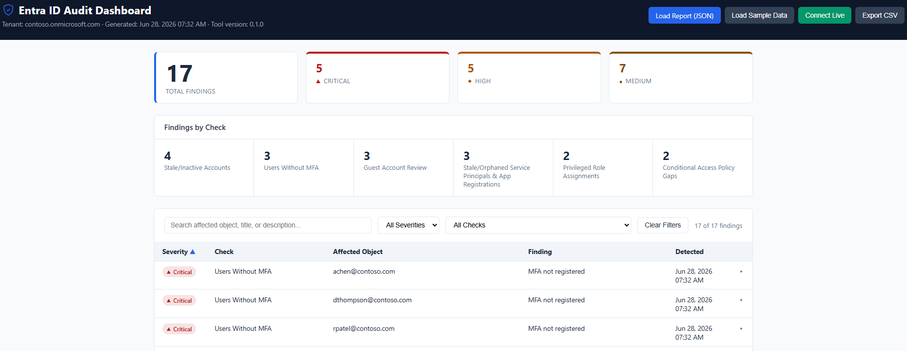

# Entra ID Audit Tool

[](.github/workflows/pester-tests.yml)
[](LICENSE)
[](https://github.com/Josperdo/entra-id-audit-tool/commits/main)

Automated identity governance audit dashboard for Azure/Entra ID.



## Why This Exists

Identity sprawl is one of the most common root causes behind cloud security incidents — stale guest accounts, users without MFA, orphaned admin roles, and over-privileged service principals accumulate silently in most Entra ID tenants. Manually auditing these conditions through the Azure portal doesn't scale and is easy to skip. This tool automates a repeatable identity governance audit against Microsoft Graph so findings are consistent, documented, and reviewable over time.

## What It Does

The tool runs six audit checks against a tenant via Microsoft Graph API and produces a structured report:

1. **Stale/inactive accounts** — enabled members with no sign-in past a threshold, or none ever
2. **Users without MFA** — accounts with no MFA method registered
3. **Guest account review** — enabled guests that never signed in or have gone inactive
4. **Privileged role assignments** — users, groups, and service principals holding one of seven high-privilege admin roles
5. **App registration credential expiry** — client secrets and certificates that have expired or are about to
6. **Conditional Access policy gaps** — no CA policies at all, or policies left disabled / in report-only mode

Each check's exact query logic, and what it intentionally does *not* cover, is in [AUDIT-CHECKS.md](AUDIT-CHECKS.md). If a check can't run (missing consent or licence), the report records it and the dashboard flags the audit as **incomplete**, so a skipped check is never mistaken for a clean result.

Results are exported to JSON and rendered in a self-contained HTML dashboard for review. The dashboard can also run entirely in the browser via **Live Mode** — see below — calling Microsoft Graph directly instead of loading a pre-generated report.

## Quick Start

> Full setup instructions: see [SETUP.md](SETUP.md)

```powershell
# Install dependencies
Install-Module Microsoft.Graph -Scope CurrentUser

# Run the audit
.\scripts\Invoke-EntraAudit.ps1 -ConfigPath .\scripts\config\audit-config.json

# Open the dashboard
.\dashboard\index.html
```

### Live Mode (optional)

Instead of running the PowerShell script, the dashboard can authenticate to Entra ID itself and call Graph directly. This requires serving it over `http://` (MSAL.js browser auth doesn't work via `file://`) and a SPA platform on your App Registration — see [SETUP.md](SETUP.md#4-spa-app-registration-setup-live-dashboard-mode):

```powershell
npx serve dashboard
# open http://localhost:5500 and click "Connect Live"
```

## Known Limitations

- **Stale/inactive accounts**, **users without MFA**, **guest account review**, and **Conditional Access** require an **Entra ID P1 or P2** licence on the tenant. Without one, Graph returns `403 Forbidden` (`Authentication_RequestFromNonPremiumTenantOrB2CTenant`). Those checks are then skipped and listed in the dashboard's "Incomplete audit" banner; the others still run. This is a Graph licensing restriction, not a bug in the tool.
- **Privileged roles** reports *active* assignments. The underlying API can't distinguish a permanent assignment from a PIM role that is activated at scan time (see [AUDIT-CHECKS.md](AUDIT-CHECKS.md#4-privileged-role-assignments-privileged-roles)).
- **Verification scope:** run end-to-end against an M365 developer tenant without P1/P2, so the licence-gated checks are verified with mocked Graph responses in the Pester suite rather than a live tenant.
- **Live Mode requires local `http(s)` hosting**, not a `file://` URL, since MSAL.js's browser auth flow needs a real origin. File-upload and sample-data modes are unaffected and still need no server.

## Testing

```powershell
Invoke-Pester ./tests -Output Detailed
```

33 Pester tests run in CI on every push, with no tenant or Graph SDK needed. All Graph access goes through a single function (`Invoke-GraphQuery`), so the suite mocks that one seam to exercise every check against canned Graph responses, including the edge cases that broke earlier versions (null `signInActivity`, throttling, non-HTTP errors). See [TECHNICAL.md](TECHNICAL.md#testing).

## Documentation

- [SETUP.md](SETUP.md) — prerequisites and local setup
- [TECHNICAL.md](TECHNICAL.md) — architecture and design decisions
- [AUDIT-CHECKS.md](AUDIT-CHECKS.md) — details on each audit check
- [CLOUD.md](CLOUD.md) — cloud architecture and integration notes
